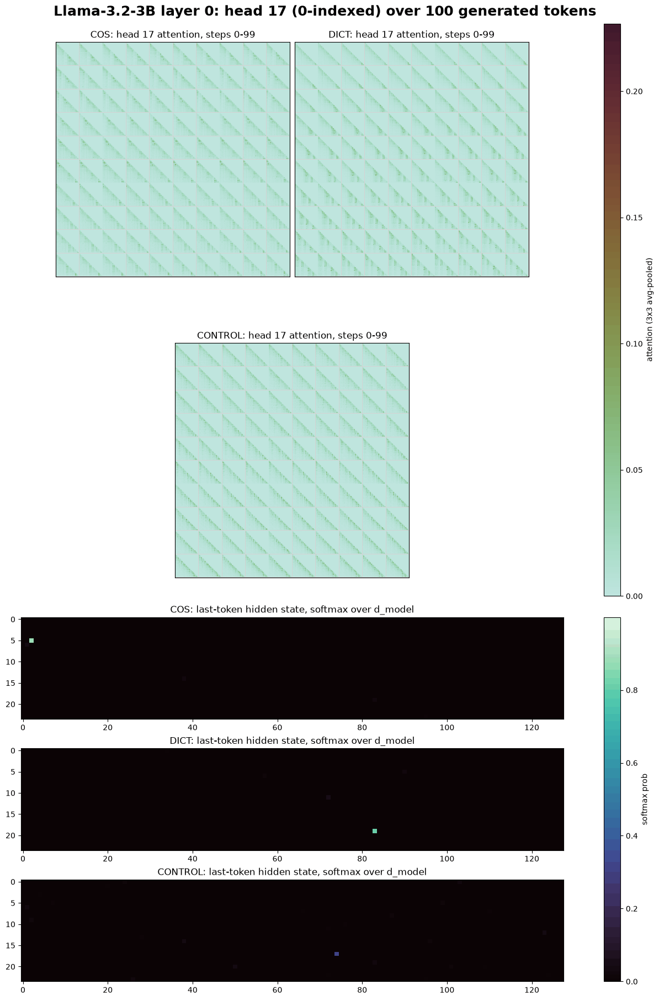
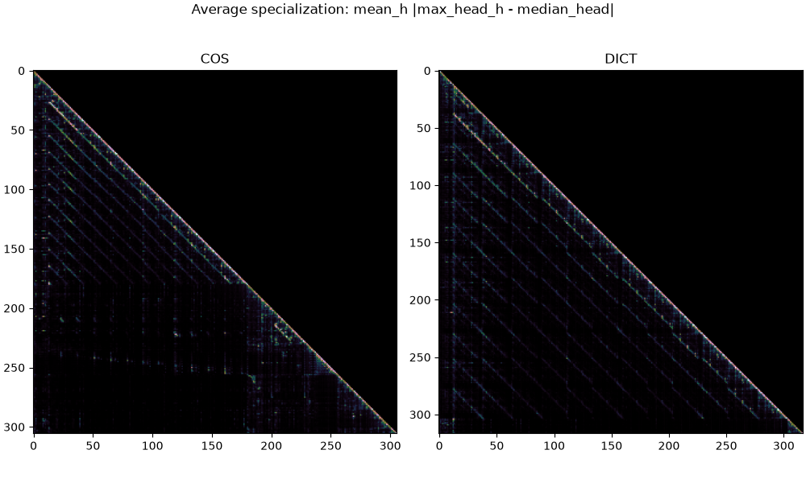

# How does input encoding change what an LLM attends to?

A small mechanistic-interpretability probe of **Llama-3.2-3B-Instruct**, run locally with
[MLX](https://github.com/ml-explore/mlx). The same data is given to the model in different encodings,
and the probe records what an attention head and the residual stream do at every layer, for every
generated token.



## Why mechanistic interpretability

AI has the power to do immense good or immense harm. On the harmful end, there are reports of chatbots
encouraging vulnerable users toward self-harm. On the good end, LLMs can produce robust, meaningful code
far faster than a person can, though their mistakes can be harder for a human to catch. That's why this
repository includes a script that checks its refactored code against my original, line for line, and
confirms they give identical results.

Many of AI's harms land directly on its users, and many come down to the same problem: we build massive
models that perform amazingly but are essentially black boxes. We can train in safeguards with
reinforcement learning, but we often don't know what mechanisms actually develop inside the model to
carry them out. I care about people the most, and to better care for the people affected by these black
boxes, I want to look inside them. That is why I've become fascinated by mechanistic interpretability: a
field focused on taking trained models apart and understanding the mechanisms they develop, so we can
better steer them away from harmful behaviour.

This repository is a small first step: does the way data is encoded in a prompt change what a model
attends to and how it represents that data internally?

## The experiment

**Data.** Yearly airline passenger totals, 1949–1960 (seaborn's `flights` dataset). Passengers grow
every year, from 1,520 in 1949 to 5,714 in 1960.

**Three prompts** (in [`prompts/`](prompts/)), each asking the model for a short report:

| Prompt | What the model sees |
|---|---|
| **COS** | Each year as a symbolic bucket relative to the median, e.g. `<g n="1949"> [-----] </g>` … `<g n="1960"> [++++++++] </g>`, with a short key to the symbols. |
| **DICT** | The same data as a raw Python list in ascending year order: `[{'year': 1949, 'sum': 1520, 'mean': 126.67}, …]`. |
| **CONTROL** | Unrelated narrative prose (a short story), as a baseline for ordinary text. |

> The code that produces the COS encoding is not part of this repository. The encoded prompt itself is
> included, so every result here is reproducible from `prompts/cos.txt`.

**Probe.** [`attnscope`](attnscope/) re-implements a Llama decoder block by hand (RMSNorm → grouped-query
attention with RoPE and a causal mask → SwiGLU MLP, with residual adds), so the attention of every head is
available. Generation is greedy, up to 100 tokens, re-running the full sequence at every step (no KV
cache). At each step and each of the 28 layers it records:

* **`attn_window`**: head 17's attention map (0-indexed), smoothed with a 3×3 average pool and cropped to
  the bottom-right 100×100 block, i.e. the most recent 100 tokens attending to the most recent 100 tokens.
  As generation proceeds, this window slides forward over the model's own output.
* **`last_hidden`**: the last token's residual stream after the model's final RMSNorm (3072 dimensions).

## Reading the figures

Each frame of the GIF is one layer (also saved individually in [`figures/final/`](figures/final/)):

* **Top three panels:** head 17's attention window at all 100 generation steps, for COS, DICT and CONTROL,
  tiled left-to-right, top-to-bottom (step 0 top-left, step 99 bottom-right). All three share one colour
  scale.
* **Bottom three panels:** the last token's hidden state at the final step, reshaped to 24×128 and
  softmaxed **across hidden dimensions**. This is *not* a next-token distribution. It shows which residual
  dimensions dominate in magnitude: a single bright pixel means one dimension dwarfs the rest.

## What these runs show

These are observations from one model, one head and one greedy run per prompt, so treat them as leads for
further work, not conclusions.

* **The model reads the trend from both encodings, but only DICT invites numbers it gets wrong.** COS
  produces a qualitative report ("a steady increase … with a notable acceleration in the mid-1950s").
  DICT gets the direction right but misstates figures that are in its own prompt: it puts the peak in 1959
  (it's 1960) and says the mean rose 49.5% (it rose about 276%).
* **COS drives the last token's state onto a single dimension in the early layers.** In layers 3–7 the
  hidden-state softmax puts 0.98–1.0 of its mass on one dimension (3039) for COS, against 0.20–0.43 for
  DICT. Averaged over all layers it is 0.57 for COS, 0.39 for DICT and 0.62 for CONTROL. This describes the
  100th generated token only; `notebooks/03_final_figures.ipynb` prints the dominant dimension for every
  layer.
* **Head 17 is not sharper for COS overall.** Its average late-step attention peak is 0.095 for COS, 0.095
  for DICT and 0.093 for CONTROL. Individual layers differ in both directions, and CONTROL shows the
  cleanest diagonal stripes (attention at fixed distances back), e.g. at layer 14.
* **Across all heads in one forward pass, the encodings look structurally different.** In the
  "average specialization" map below (where heads disagree with the typical head), COS shows diagonal
  stripes through the symbol lines and a distinct block where the instructions start; DICT shows evenly
  spaced stripes across the whole record list.



## Limitations and next steps

**Why head 17.** Head 17 was chosen during exploratory work in summer 2026 because its patterns looked
the most interesting. It is not the result of a systematic search. `generate_and_capture(head=...)` makes
any head a one-line change.

**An approach that didn't work.** An earlier version picked each layer's head dynamically with
`most_active_head` and zoomed in with `focus_window` (see `notebooks/01_single_pass_head_comparison.ipynb`).
The resulting comparisons were less informative than following one fixed head, so the main experiment
tracks a single head. One hypothesis worth checking: the most concentrated heads are often "attention
sink" heads that pile attention onto the first token, which looks the same for every prompt.

**Next steps.**

* **Score every layer and head.** Capture all 24 heads in one pass and rank where COS differs most from
  DICT and CONTROL, so head choice becomes a result instead of a guess.
* **One figure across all generated tokens, for any number of prompts.** Measure attention by how far
  back each token looks instead of by position (prompts have different tokens at each position, so maps
  can't be compared pixel by pixel), and stack one row per generated token.
* **Pattern-seeking "cameras".** Instead of following the single hottest spot, detect known attention
  patterns in each map (sinks, fixed-offset diagonals, induction-style stripes, attention to separators
  such as newlines) and track how they change across layers and encodings.

## Repository layout

```
attnscope/        the probe: forward pass, capture loop, figures (see attnscope/README.md)
notebooks/
  01_single_pass_head_comparison.ipynb   one forward pass, COS vs DICT, all heads   (MLX)
  02_generate_and_capture.ipynb          generate and capture -> data/              (MLX)
  03_final_figures.ipynb                 build figures/final from data/             (any machine)
prompts/          cos.txt, dict.txt, control.txt
data/             captured arrays, one compressed .npz per prompt (see data/README.md)
figures/final/    per-layer comparison figures + GIF
figures/single_pass/  notebook 01's figures
original/         the original summer-2026 research code, preserved for reference (not run)
scripts/
  check_against_original.py   runs the original code and the repo code side by side (MLX)
```

## Running it

**Rebuild the figures (any OS):**

```bash
pip install -r requirements.txt
jupyter lab notebooks/03_final_figures.ipynb
```

**Regenerate the data, run the single-pass analysis or the equivalence check (Apple Silicon only):**

```bash
pip install -r requirements-mlx.txt
jupyter lab notebooks/02_generate_and_capture.ipynb
python scripts/check_against_original.py --model
```

The model (`mlx-community/Llama-3.2-3B-Instruct`, about 6 GB) downloads from Hugging Face on first use.
Generation is deterministic: re-running notebook 02 reproduces `data/` bit for bit.

## Notes

* **Prompt formatting quirk, kept on purpose.** Prompts are read with `" ".join(f.readlines())`, as in the
  original experiment, which adds a space after every newline. `attnscope.scope.load_prompt` keeps this.
* **Precision.** The hand-written block computes attention (and so the residual stream) in float32, unlike
  `mlx_lm`'s fused bf16 attention, so its activations differ slightly from the stock forward pass. Arrays
  are stored as float16 to keep each file under GitHub's 100 MB limit.
* **Head numbering.** Heads are 0-indexed throughout, so head 17 is the 18th head.

## How this repository was built

I designed and ran this experiment in summer 2026. For this repository I worked with Claude to turn that
exploratory code into the cleaner, documented version here. The original code is preserved in
[`original/tylerscope_summer2026.py`](original/tylerscope_summer2026.py), the comments in `attnscope/`
point each new line back to the original line it replaces, and
[`scripts/check_against_original.py`](scripts/check_against_original.py) confirms the two produce
bit-for-bit identical outputs.
